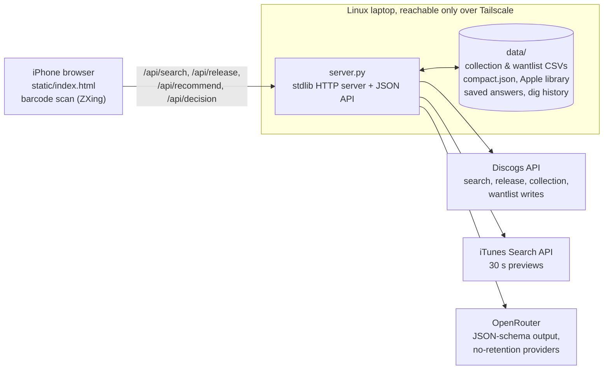

# Crate Digger

A personal web app for deciding on a record while standing at a shop's crate. Scan the barcode with an iPhone and within a few seconds the card shows:

- whether you already own it (on your Discogs shelf, or only in Apple Music);
- one sentence on what the record is, and its main style;
- the up-to-three records you already own or listen to that are **closest in sound**, each with a reason, or an honest "nothing close";
- where it sits among your labels and musicians, 30-second samples, and the lowest Discogs price;
- **Buy**, **Explore later** and **Wishlist**, which write to your Discogs account and can be undone.

It is a working prototype that I use in record shops. The aim was to answer one question: does trustworthy evidence from your own collection help you decide faster? Live use says yes: a decision takes about 30 seconds from the card appearing.

> This is a single-user tool built around my own Discogs account and Apple Music library. It is published to show the product thinking, the evaluation and the engineering process, not as a hosted service.

## Results

The recommendation is one structured call to a language model, evaluated against a fixed set of 20 records that I labelled before seeing any model output (`data/eval_set.json`). The scores in [`docs/STATUS.md`](docs/STATUS.md) are generated from the saved runs and my reviews.

| Criterion | Target | Primary model (`gpt-5.6-luna`) | Fallback (`claude-haiku-5.5`) |
| --- | --- | --- | --- |
| Records given a specific style | 18 of 20 | 20 of 20 ✅ | 19 of 20 ✅ |
| Style accuracy | 90% | 89% (16 of 18) | 88% (15 of 17) |
| False close matches | at most 15% | 15% (3 of 20) ✅ | 25% (5 of 20) |
| Median latency, cost per record | | 5.6 s, US$0.007 | 6.0 s, US$0.005 |
| Decision in under 60 s | | passed in live use | |

Style accuracy is one record short of its target; both misses are borderline records. The false-match rule is deliberately strict: any pick on a record labelled "nothing close is known" counts as false.

## How it works



1. **Identify.** The page reads the barcode with the camera (or takes a catalogue number or artist and title) and the backend searches Discogs. If several editions match, you pick one; the app never guesses an edition.
2. **Own it?** The release, its master and other pressings are checked against local snapshots of the Discogs collection and the Apple Music library. These appear first, before any model call.
3. **Connections.** `engine.py` lists shared labels, musicians and producers with records on the shelf. This is rule-based and takes no model call.
4. **Recommendation.** `harness.py` sends the record, the shelf and the library (with play counts and liked tracks) to the model with a strict JSON schema: a sentence, one style from 24 families defined in `styles.py`, and up to three picks by ID with reasons. The server drops any ID not in the lists, allows zero picks, and never turns a timeout into a guess. Answers are cached under a hash of model, prompt, lists and record, so each record costs one call at most, even if several requests arrive at once.
5. **Decide.** Buy adds the release to the Discogs collection and Wishlist to the wantlist. Every tap is saved in a local dig history, and Undo reverses both the Discogs change and the history entry.
6. **Refresh** downloads the full collection and wantlist from Discogs and fetches details only for new records. A list is saved only once it has fully downloaded, so a failed sync keeps the previous one.

### Design choices

- **The model chooses by sound; tags only explain.** The first design matched records by Discogs style tags and kept the model out. A Phase 0 test on my own data showed that tags are too coarse to say what a record sounds like, and that a model choosing from my actual library does it well. That result reversed the design (see the first entry in [`docs/decisions.md`](docs/decisions.md)).
- **"Nothing close" is a correct answer.** The prompt and the scoring both reward an empty pick list over a weak pick, because a misleading match in a shop costs more than no match.
- **Python standard library only, no framework, no database.** One person and a few hundred records: JSON and CSV files with atomic writes and locks are enough. The decision log records when this should change.
- **Secrets stay on the server.** The Discogs token and OpenRouter key never reach the browser. The server listens on loopback and is exposed only to my private tailnet with `tailscale serve`, never to the public internet, because the app has no login.
- **Cost and privacy are explicit.** Model calls are routed only to providers that honour the JSON schema and keep no request data, and every call reports its cost. Prices, wantlist and dig history are never sent to the model.

## How it was built

I wrote the product requirements, made the product decisions and labelled the evaluation data. The code was written with AI coding agents (Claude Code and OpenAI Codex) working under the process below. The repository is a record of that process as much as of the app.

**Requirements and experiment first.** [`Crate Digger Product Requirements v5.md`](Crate%20Digger%20Product%20Requirements%20v5.md) defines the problem, the prototype scope and a measurable acceptance test before any app code. Phase 0 tested the matching idea on real data with no app at all (`engine.py`, `sound_picks.py`, `narrowed-test/`).

**An evaluation harness, with rules the code can't bend.**
- `harness.py` runs both models on the 20 labelled records; runs are saved in `data/runs/`.
- I review each pick in the conversation, and the verdicts go into `data/review*.json`.
- `scripts/report.py` regenerates `docs/STATUS.md` from those files, so results are never copied by hand.
- A pre-commit hook rejects any change to the labels unless I make it explicitly, so a model can't be "improved" by moving the target.

**A decision log.** [`docs/decisions.md`](docs/decisions.md) holds about 30 dated decisions, each with its reason, appended and never rewritten. Examples: why Pass was dropped, why prices link to Australian sellers instead of showing a range, why a tracked file was removed.

**Multi-agent development with guardrails.** [`AGENTS.md`](AGENTS.md) is a single instruction file shared by Claude Code, Codex and other agents. A lead agent owns `main`, and each task runs in its own git worktree and branch with a written brief (`docs/tasks/`):

| Command | Does |
| --- | --- |
| `make task` / `make worker` | Creates a task branch and worktree with linked data and its own test port, and optionally starts a worker agent in it |
| `make test` | Runs 93 Python `unittest` tests and 44 `node:test` page tests; also the pre-commit hook |
| `make deploy` | Refuses on a dirty tree or failing tests, restarts the service, checks it answers, logs the commit |
| `make replay` | Re-runs an archived task with a different model and grades it against the reviewed result |

**Choosing models on evidence.** Worker models are not chosen by reputation. `scripts/grade.py` replays finished tasks with a candidate model and checks five gates: hidden reference tests, the whole suite, output on real data identical to the reviewed version, staying inside the task's files, and a blind code review. Results are in [`docs/tasks/replays.md`](docs/tasks/replays.md). That evidence set the tier table in `AGENTS.md`: cheap models for mechanical changes, mid-size models for specified features, the largest model for open design.

**Independent review.** Larger changes are reviewed by a separate agent that did not write them. For example, the server-hardening round (`docs/tasks/server-hardening.md`) fixed a loopback-only default, partial failures after Discogs writes, a serialized refresh and one paid call per record.

## Repository map

| Path | What |
| --- | --- |
| `server.py` | Backend: snapshots, Discogs lookups, samples, recommendations, decisions, JSON API |
| `static/index.html` | The whole iPhone web app: scanning, card, edition picker, Explore later list |
| `harness.py`, `check_models.py` | Model prompt, schema and calls; checks the model IDs and structured-output support on OpenRouter |
| `styles.py` | The 24 style families and their one-line definitions used in the prompt |
| `engine.py`, `library.py`, `build_compact.py` | Shelf records, Apple Music library parsing, the compact catalogue |
| `discogs_sync.py`, `discogs_write.py` | Account sync (all pages, publish only when complete) and Buy/Wishlist/Undo |
| `scripts/` | Report, grading and replays, deploy, status, task and worker setup |
| `tests/` | Python and page tests; `tests/page-harness.cjs` runs the page against a fake backend |
| `docs/` | Status, decisions, archived task briefs, replay results |
| `data/` | Only the evaluation labels and reviews are tracked; personal exports, downloads and caches stay local |

## Running it

It needs a Discogs account and personal token, an OpenRouter key, and optionally an Apple Music `Library.xml` export.

```sh
make setup                                   # enable the git hooks
echo "<discogs token>" > discogs_token.txt && chmod 600 discogs_token.txt
export OPENROUTER_API_KEY=...                # in production, loaded only by the systemd service
python3 server.py                            # http://127.0.0.1:8000, downloads your collection on start
make test
```

## Status and next steps

- The prototype acceptance test is mostly met (above); the photographed-crate test is still to do.
- Later: a native iPhone app with Discogs sign-in, which would need real authentication and a backend for more than one user.
